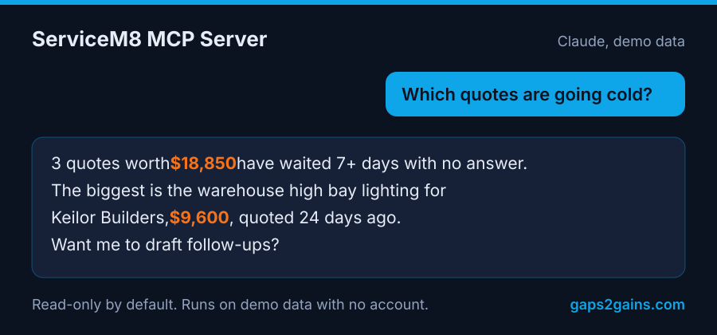

# ServiceM8 MCP Server

Built by Gaps2Gains. We cut a moving company's inquiry reply time from 13.8 hours to 9 seconds. [Book a Free Discovery Call](https://gaps2gains.com/diagnosis)



[](https://github.com/dwadlane/servicem8-mcp/actions/workflows/ci.yml) [](LICENSE) [](https://github.com/dwadlane/servicem8-mcp/releases)

Ask Claude about your ServiceM8 business in plain English. "Which quotes should I chase today?" "What's on tomorrow's schedule?" "Log this call as a new quote."

An [MCP](https://modelcontextprotocol.io) server by [Gaps2Gains](https://gaps2gains.com) that connects Claude (Desktop, Code or any MCP client) to the ServiceM8 job management platform used by trade and field service businesses.

## What an Owner Can Ask

> **You:** Which quotes are going cold?
>
> **Claude:** 3 quotes worth $18,850 have waited 7+ days with no answer. The biggest is the warehouse high bay lighting for Keilor Builders, $9,600, quoted 24 days ago. Want me to draft follow-ups?

> **You:** How's the pipeline looking?
>
> **Claude:** $37,750 is sitting in open quotes and $5,150 is booked. You've won 80% of the quotes that got a decision.

> **You:** Who's where today?
>
> **Claude:** Matt is at Dana Whitfield's in Niddrie at 8 AM for the split system circuits. Priya is at Greenvale Dental at 10 AM for the LED upgrade.

## Tools

| Tool | What it does | Writes? |
|---|---|---|
| `cold_quotes` | Quotes not yet won or lost, oldest first, with the total dollars waiting | No |
| `pipeline_summary` | Open quotes, booked work, completed and lost, with win rate | No |
| `schedule` | Booked visits for a day: time, staff, client, job, address | No |
| `list_jobs` | Jobs by status, with search across client, description, address and job number | No |
| `get_job` | One job with client, value, diary notes and booked visits | No |
| `find_clients` | Search clients by name or address | No |
| `create_job` | Create a Quote or Work Order, for example from a phone call | Yes |
| `add_job_note` | Add a call summary or follow-up to the job diary | Yes |

**Read-only by default.** The two write tools only appear when you set `SERVICEM8_ALLOW_WRITES=1`.

## Try It in 2 Minutes, No Account Needed

With no API key it runs on demo data for a fictional Melbourne electrician, Bright Spark Electrical.

```bash
git clone https://github.com/dwadlane/servicem8-mcp.git
cd servicem8-mcp
npm install && npm run build
```

Add it to Claude Desktop (`claude_desktop_config.json`):

```json
{
  "mcpServers": {
    "servicem8": {
      "command": "node",
      "args": ["/full/path/to/servicem8-mcp/dist/index.js"]
    }
  }
}
```

Or in Claude Code:

```bash
claude mcp add servicem8 -- node /full/path/to/servicem8-mcp/dist/index.js
```

## Connect Your Real ServiceM8 Account

1. In ServiceM8, go to **Settings, API Keys** and create a key.
2. Add it to the config:

```json
{
  "mcpServers": {
    "servicem8": {
      "command": "node",
      "args": ["/full/path/to/servicem8-mcp/dist/index.js"],
      "env": {
        "SERVICEM8_API_KEY": "your-key",
        "SERVICEM8_ALLOW_WRITES": "0"
      }
    }
  }
}
```

The key stays on your machine and goes only to `api.servicem8.com` in the `X-Api-Key` header.

## When It Stops

- **Writes are off unless `SERVICEM8_ALLOW_WRITES=1`.** Out of the box it only reads.
- **It never deletes.** There is no delete tool, so nothing in ServiceM8 can be removed through it.
- **It only reads what the API key's account can see.** If the key can't see a record, Claude can't either.

## How It's Built

- TypeScript on the official [MCP SDK](https://github.com/modelcontextprotocol/typescript-sdk), with input checks on every tool.
- Uses ServiceM8's REST API with server-side `$filter` queries, then double-checks results so a loose filter never leaks the wrong records.
- Plain-English errors for a bad key (401) and rate limits (429).
- One small client interface, so the demo data and the live API run the same tool code.
- 10 tests covering every tool and the HTTP layer: `npm test`.

## Roadmap

- [MYOB MCP Server](https://github.com/dwadlane/myob-mcp) is live. Run both and Claude can match jobs to unpaid invoices.
- Remote hosting on Cloudflare Workers so a whole team can connect without installing anything.

## Want This Wired Into Your Business?

We build Claude connectors, AI receptionists and back office systems for trade and service businesses. [Book a Discovery Call](https://gaps2gains.com/diagnosis).

Not affiliated with or endorsed by ServiceM8.

## License

MIT
